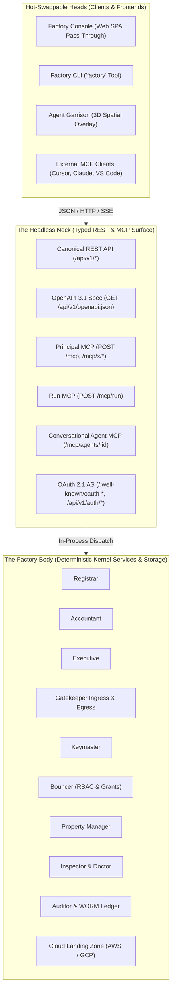

# Agent Factory: Headless Neck & Hot-Swappable Heads Plan

## 1. Intent: Body / Neck / Hot-Swappable Heads

The Agent Factory architecture is explicitly divided into three layers:

1. **The Body (Kernel Services & State)**:
   The deterministic, authoritative core: Registrar, Accountant, Executive, Gatekeeper Ingress and Egress, Keymaster, Bouncer, Property Manager, Inspector, Doctor, and Auditor. The Body holds state, enforces invariant policies, meters spend, and controls container runtimes. The Body does **not** expose separate MCP servers per kernel staff member.
2. **The Neck (Unified Headless REST & MCP Projection)**:
   The single, typed contract through which all Factory operations are exposed. Generated from one declarative operations contract (`packages/contract`):
   - Canonical REST API (`/api/v1/*`)
   - OpenAPI 3.1 Document (`GET /api/v1/openapi.json`)
   - Principal MCP (`POST /mcp` with bounded default `core` toolset ≤40, `/mcp/x/{toolsets}`, `/mcp/readonly`, and `/mcp/x/all`)
   - Run MCP (`POST /mcp/run`) for container run-token callers
   - Conversational Agent MCP (`agents_converse` and optional `/mcp/agents/:id`)
   - OAuth 2.1 Authorization Server with PKCE, dynamic client registration, and multi-client `mcp:<client_id>` support
3. **Hot-Swappable Heads (Clients & Frontends)**:
   Zero-authority presentation and orchestration overlays. Any head can be swapped, redesigned, or replaced without altering the Body or Neck:
   - **Factory Console**: A stateless, pass-through SPA forwarding caller identity and session tokens.
   - **Factory CLI**: A local terminal tool for operators and scripts using the shared operations catalog.
   - **Agent Garrison**: A 3D municipal and spatial overlay storing hex coordinates and world state, delegating 100% of Factory identity, state, and execution to the Neck.
   - **External AI Clients**: Cursor, Claude Desktop, VS Code Copilot, ChatGPT, and autonomous subagents connecting via standard MCP.

---

## 2. Requirements

- **100% Capability Parity**: All 14 missing domains from the headless audit (Configuration Agent CRUD/import/convert, deploy/retire/reinstate/purge, runs list/cancel, multi-turn conversations, runtime rollout, subscriptions/BYOM, spend/budgets/policy, skills ecosystem, external systems, Keymaster status, schedules CRUD, identity links, groups, transfers, submissions, ledger verify, triage, and metrics) exposed over REST and MCP.
- **Strict MCP Protocol Compliance**: JSON-RPC 2.0 conforming to MCP Specification 2024-11-05+; protocol-level version negotiation; HTTP 202 on notifications; RFC-compliant error responses where business refusals return `isError: true` with explanatory text rather than hiding refusal rationale under JSON-RPC `-32001` (`CL3`); tool annotations (`readOnlyHint`, `destructiveHint`, `outputSchema`).
- **Cryptographic & Bouncer Scoping**: Dynamic tool filtering in `tools/list` strictly evaluating caller roles intersected with `keyScopes` (`R6`, `D14`, `D23`).
- **Secret & Key Isolation (`CL6`, `K5`, `S1`)**: Plaintext secrets and raw `fk_` keys never enter or leave MCP tool arguments or results. Secret provisioning uses session-bound single-use URL elicitation handoffs. `POST /api/v1/keys` and key rotation remain `console-or-cli-only`.
- **Human-Judgement Safeguards (`E9`, `D27`, `D29`)**: Critical human-in-the-loop decisions (`decide_approval`, admission of content, skills, or systems) cannot be autonomously executed by an LLM over MCP. They require explicit human confirmation (client-rendered elicitation or Console/Discord handoff) and are ledgered with `via: mcp:<client_id>`.
- **OAuth 2.1 AS & Multi-Client Support (`D14`, `A1`)**: Dedicated OAuth 2.1 Authorization Server supporting dynamic client registration (RFC 7591), PKCE (RFC 7636), mandatory per-client consent screens, and multi-client `deviceFamily: "mcp:<client_id>"` with audience-bound (`RFC 8707`) short-lived `fk_at_` tokens and durable rotating `fk_rt_` refresh tokens.
- **Edge Security & Path Bypass (`A1`)**: Path-scoped Cloudflare Access bypass for `/login`, `/api/v1/auth/*`, `/.well-known/oauth-*`, and `/mcp*`, backed by fail-closed Factory enforcement (`D18`), rate limiting, and bot challenge exclusion.

---

## 3. Confirmed Architectural Decisions (1–12)

1. **Body / Neck / Hot-Swappable Heads Triad**:
   Reject "one MCP server per kernel staff member". The ten kernel services remain an integrated Body. The Neck exposes one Principal MCP surface (`/mcp`) plus explicit Conversational Agent endpoints. Heads are stateless, zero-privilege clients.
2. **Curated 1:1 Explicit Tools (`B1`) over Polymorphic CRUD (`B2`) or Server-Side Meta-Tools (`B3`)**:
   Implement ~110–130 privilege-aligned explicit tools (`1-operation = 1-tool`). Polymorphic CRUD tools violate MCP input schema constraints (no root `oneOf`), corrupt tool annotations (`destructiveHint` applies to the entire tool), and break fine-grained Bouncer RBAC. Server-side meta-tools degrade client observability.
3. **Task-Domain Toolsets & Bounded Default (`core` ≤40)**:
   Root `/mcp` serves a curated `core` toolset bounded to ≤40 tools, preventing VS Code Copilot hard failures (>128 tools) and Cursor silent tool dropping (>40–80 tools). Clients select domain toolsets via URL path (`/mcp/x/{toolsets}`), header (`X-MCP-Toolsets`), or `/mcp/readonly`. Tool-search clients (Claude / Claude Code) opt into all tools via `/mcp/x/all`.
4. **Single Operations Contract & In-Process Dispatch (`CL11`)**:
   All operations are defined once in `@beercanlabs/factory-contract` with typed request, response, and metadata schemas. This contract generates REST route handlers, OpenAPI 3.1 (`GET /api/v1/openapi.json`), MCP tool definitions, CLI `tools.ts`, and the Console API client. MCP dispatches in-process directly through canonical route handlers, eliminating duplicate logic in `mcp.ts`.
5. **Separation of Principal MCP (`POST /mcp`) and Run MCP (`POST /mcp/run`)**:
   Disentangle the multiplexed `/mcp` endpoint. Principal MCP (`/mcp`) serves authenticated human/service callers via OAuth or `fk_` keys. Run MCP (`/mcp/run`) serves active agent containers presenting a `FACTORY_RUN_TOKEN` for in-run tasks (`get_agent_models`, `spawn_subagent`, `mailbox`).
6. **Conversational Agent Surface (`agents_converse` + `/mcp/agents/:id`)**:
   Conversational agents (Personal Trainer, Agent Builder, Higgins, and custom user assistants) are exposed through an `agents_converse` tool on Principal MCP and optional dedicated `/mcp/agents/:id` endpoints, fulfilling user expectations without fracturing control-plane operations.
7. **Human-Decision Safeguards (`E9`, `D27`, `D29`)**:
   Operations requiring human judgement (held approvals, admission of content, skills, or systems) are classified as `human-decision`. When called over MCP, the model is barred from self-approving. The Factory requires explicit human confirmation click via MCP elicitation or a short-lived Console/Discord handoff URL, recording `via: mcp:<client_id>` in the WORM ledger.
8. **Secret Exclusions & Session-Bound URL Elicitation (`CL6`, `K5`)**:
   Keymaster credential writes, provider secrets, OAuth secrets, Discord bot tokens, and raw API key issuance (`POST /api/v1/keys`) are excluded from MCP tool parameter schemas. Secret-entry routes use session-bound, single-use URL elicitation handoffs requiring an active browser session of the identical principal.
9. **OAuth 2.1 AS with Mandatory Consent Screen**:
   Because the Factory issues 12-hour browser session cookies, `/authorize` must never silently auto-approve dynamic OAuth clients. The AS displays a mandatory consent screen showing `client_name`, redirect URI host, and requested scopes, remembering consent per `(principal, client_id, scope)`.
10. **Multi-Client `deviceFamily: "mcp:<client_id>"` (`D14` Amendment)**:
    Amend `D14` to allow multiple active MCP clients per principal. Instead of a single `'mcp'` family that clobbers logins across devices, each client receives a distinct `mcp:<client_id>` family, short-lived audience-bound (`RFC 8707`) `fk_at_` access tokens, and durable rotating `fk_rt_` refresh tokens stored in S3 config storage.
11. **Path-Scoped Cloudflare Edge Bypass (`A1` Amendment)**:
    Permit Cloudflare Access path bypass on `/login`, `/api/v1/auth/*`, `/.well-known/oauth-*`, and `/mcp*`, alongside signature-verified webhooks and `fk_`-rewritten `/api/v1*`. The Factory enforces fail-closed authentication (`D18`, `S14`), Cloudflare Bot Fight challenges are bypassed on `/mcp*`, and endpoint rate limiting is applied.
12. **Hot-Swappable Head Cleanups & Deprovisioning**:
    Fix the Console false-green `verifyLedgerWorm()` catch; update `AgentWorkbench.tsx` `ACTOR_RE` to accept `user:<id>`; delete false `POST /graphql` spec references; and implement complete cloud teardown (IAM roles, ECR images, ECS task definitions) on `POST /api/v1/registry/agents/:id/purge`.

---

## 4. Exposure Classes

Every Factory operation is assigned one of six exposure classes:

| Class | Definition | Routing & MCP Exposure | Examples |
| :--- | :--- | :--- | :--- |
| `tool` | Standard read or non-destructive operation. Automated execution allowed. | Exposed as 1:1 tool in Principal MCP and REST. | `whoami`, `list_agents`, `get_agent_models`, `query_ledger`, `list_runs` |
| `tool-confirm` | State-mutating operational change. Requires client-side prompt confirmation. | Exposed as 1:1 tool with `destructiveHint: true`. | `pause_agent`, `resume_agent`, `retire_agent`, `delete_schedule`, `set_agent_models` |
| `human-decision` | Governance, admission, or held-approval action requiring human judgement (`E9`). | Exposed over MCP requiring client-rendered elicitation confirmation or Console handoff. | `decide_approval`, `admit_submission`, `admit_skill`, `admit_system` |
| `handoff` | Sensitive secret entry, token import, or interactive third-party OAuth setup. | Returns session-bound single-use URL elicitation handoff. Raw secret never in tool arguments. | `set_platform_credential`, `set_agent_credential`, `connect_subscription` |
| `console-or-cli-only` | High-privilege root operations forbidden over MCP to protect credentials (`CL6`). | REST only; excluded from all MCP tool catalogs. | `POST /api/v1/keys` (issue key), `POST /api/v1/keys/:id/rotate` |
| `internal` | Container runtime, egress, or intra-cluster coordination endpoints. | Excluded from Principal MCP. Container tools routed to `/mcp/run`. | `/mcp/run`, `/api/v1/gatekeeper-egress/*`, `/internal/*` |

---

## 5. Implementation Slices (Stories TSK-335 through TSK-341)

### Slice 1: Headless Neck Plan, DA Amendments & Spec Cleanup (`TSK-335`)
- Author `plans/headless-neck.json` and `plans/headless-neck.md`.
- Amend `DESIGN_AUTHORITY.md` §4 (`GAP-248`..`GAP-253`), §5 (`TSK-335`..`TSK-341`), §6 (`E9`, `K5`, `CL6`, `CL11`, `A1`), and §7 (audit log).
- Amend `plans/factory-auth.md` for `D14` multi-client support.
- Remove all false `POST /graphql` claims from `SPEC.md` and `KPF.md`.

### Slice 2: Operations Contract, Route Schemas & OpenAPI 3.1 (`TSK-336`)
- Create `@beercanlabs/factory-contract` operations registry unifying routes, input/output schemas, and privileges.
- Expose `GET /api/v1/openapi.json` (OpenAPI 3.1) and `GET /api/v1/mcp/schema.json`.
- Enforce contract conformance: CI fails if any route lacks schema or privilege bindings.

### Slice 3: MCP Protocol Compliance, Refusal Clarity & Error Refactoring (`TSK-337`)
- Update `mcp.ts` to strictly comply with MCP JSON-RPC 2.0 specifications.
- Implement HTTP 202 on notifications, version negotiation, and tool annotations (`readOnlyHint`, `destructiveHint`, `outputSchema`).
- Fix `CL3` refusal reporting: return `isError: true` with explanatory text rather than hiding refusal rationale under `-32001`.
- Fix `tools/list` to evaluate Bouncer roles intersected with `keyScopes`.
- Remove `actAs` from tool parameter schemas; separate Run MCP onto `POST /mcp/run`.

### Slice 4: Headless MCP Neck Expansion, Domain Toolsets & Conversational Agent Surface (`TSK-338`)
- Expand `POST /mcp` to cover 100% of headless capability domains (~110–130 tools) using in-process dispatch via canonical route handlers.
- Implement task-domain toolsets: bounded default `core` (≤40 tools), `/mcp/x/{toolsets}`, `/mcp/readonly`, and `/mcp/x/all`.
- Enforce `human-decision` safeguards (`E9`): require human confirmation elicitation or handoff with `via: mcp:<client_id>` ledgering.
- Implement session-bound URL elicitation for Keymaster secret writes (`CL6`).
- Expose conversational agent surface: `agents_converse` on `/mcp` and dedicated `/mcp/agents/:id` endpoints.

### Slice 5: OAuth 2.1 Authorization Server, Multi-Client `mcp:<client_id>` & Durable Refresh Store (`TSK-339`)
- Implement OAuth 2.1 AS: `/.well-known/oauth-authorization-server`, `/api/v1/auth/register`, `/authorize`, `/token`, `/revoke`.
- Support PKCE (S256), dynamic client registration, and mandatory per-client consent screen.
- Amend `D14`: support `deviceFamily: "mcp:<client_id>"`, issuing short-lived `fk_at_` access tokens and rotating `fk_rt_` refresh tokens.
- Persist OAuth clients and refresh tokens in durable S3 config storage so deploys do not invalidate sessions.

### Slice 6: Hot-Swappable Heads: Console Hardening, CLI Unification & Headless Validation (`TSK-340`)
- Fix Console `verifyLedgerWorm()` catch bug in `packages/console/src/api/client.ts`.
- Update `AgentWorkbench.tsx` `ACTOR_RE` to allow `user:<id>` principals.
- Wire `StudioView.tsx` into Console navigation or retire dead view code.
- Unify CLI `tools.ts` onto `@beercanlabs/factory-contract`.
- End-to-end headless validation across REST, MCP, and CLI.

### Slice 7: Cloudflare Edge Cutover, Live AWS Deployment & Agent Purge Deprovisioning (`TSK-341`)
- Update `landing-zones/aws/cloudflare.tf` for path-scoped bypass on `/login`, `/api/v1/auth/*`, `/.well-known/oauth-*`, and `/mcp*`.
- Configure Cloudflare bot-challenge skip on `/mcp*` and endpoint rate limiting.
- Implement complete cloud teardown (IAM roles, ECR images, ECS task definitions) in `POST /api/v1/registry/agents/:id/purge`.
- Deploy House Staff (`factory-manager`, `agent-builder`, `personal-trainer`) in production AWS.
